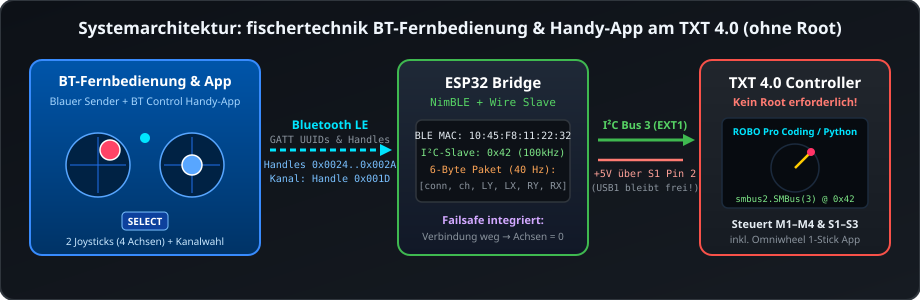
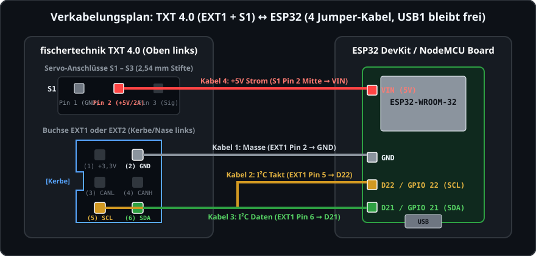
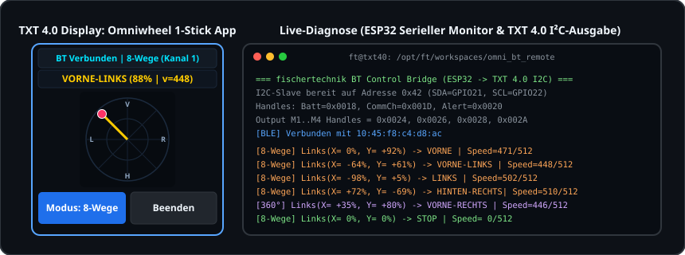

# fischertechnik Bluetooth-Fernbedienung & Handy-App am TXT 4.0 – ESP32 I²C-Bridge (ohne Root!)



Mit diesem Projekt lassen sich sowohl die **blaue fischertechnik Bluetooth-Fernbedienung** (Handsender `161942` aus dem *BT Control Set 540585*) als auch die offizielle **fischertechnik Bluetooth Control App** vom Smartphone/Tablet (Android & iOS) nahtlos am **fischertechnik ROBOTICS TXT 4.0 Controller** nutzen – **komplett ohne Root-Zugriff** auf dem TXT 4.0 und direkt kompatibel mit **ROBO Pro Coding / Python**.

---

## Unterstützte Steuerungen

1. **Blaue fischertechnik Bluetooth-Fernbedienung (Handsender):**
   Verbindet sich nach dem Einschalten vollautomatisch mit dem ESP32 (die blaue Status-LED an der Fernbedienung leuchtet dauerhaft). Alle 4 Proportionaleingänge der beiden Joysticks sowie die Kanalumschaltung (`SELECT`-Taste) stehen verzögerungsfrei am TXT 4.0 zur Verfügung.
2. **fischertechnik Bluetooth Control App (Smartphone / Handy):**
   Auch die kostenlose fischertechnik **BT Control App** auf dem Smartphone findet den ESP32 sofort über Bluetooth Low Energy und kann das Modell am TXT 4.0 genauso proportional steuern wie die physische Fernbedienung!

---

## Warum dieses Projekt? (Hintergrund & Motivation)

Für den älteren fischertechnik TXT Controller (und die Community-Firmware *ftcommunity-TXT*) gibt es das Projekt **[ftCommunity/ft_bt_remote_server](https://github.com/ftCommunity/ft_bt_remote_server)**. Auf dem neueren **TXT 4.0 Controller** steht man jedoch vor drei Hürden, wenn man die blaue Bluetooth-Fernbedienung oder die BT Control Handy-App direkt mit dem internen Bluetooth-Chip des Controllers koppeln möchte:

1. **Kein offizieller Root-Zugriff am TXT 4.0:**
   Die blaue fischertechnik-Fernbedienung verbindet sich ausschließlich mit Gegenstellen, deren Bluetooth-MAC-Adresse mit dem Präfix **`10:45:F8:...`** (*LNT Automation GmbH*) beginnt. Um die MAC-Adresse des internen Bluetooth-Chips unter Linux zu ändern (`hciconfig` / `bdaddr`) und einen eigenen Low-Level-GATT-Server zu starten, wären auf dem TXT 4.0 `root`-Rechte erforderlich.
2. **Kein Konflikt mit der internen TXT 4.0 Bluetooth-Verbindung:**
   Selbst mit Root-Rechten würde das Überschreiben der internen Bluetooth-MAC-Adresse und des GATT-Servers die normale Bluetooth-Funktionalität des TXT 4.0 (z. B. Kopplung mit dem PC/Tablet für ROBO Pro Coding) beeinträchtigen und bei Firmware-Updates überschrieben werden.
3. **Fest codierte BLE GATT-Handles in der Fernbedienung:**
   Während die Smartphone-App über die 128-Bit-GATT-UUIDs kommuniziert, sucht die physische blaue Fernbedienung nach dem Verbinden **nicht** dynamisch nach UUIDs, sondern schreibt die 4 Joystick-Achsen direkt (`Write Without Response`) auf die fest in der Fernbedienung hinterlegten GATT-Attribute-Handles **`0x0024`**, **`0x0026`**, **`0x0028`** und **`0x002A`** (sowie **`0x001D`** für die Kanalwahl).

### Unsere Lösung: Ein ESP32 als transparente BLE-zu-I²C-Brücke (`0x42`)
Ein kostengünstiger **ESP32** (~5 €) übernimmt die gesamte Bluetooth-Kommunikation mit der Fernbedienung bzw. der Handy-App:
- Er setzt seine eigene BLE-MAC-Adresse per Software auf `10:45:F8:11:22:32`.
- Über den schlanken **`NimBLE-Arduino`**-Stack stellt er sowohl sämtliche 128-Bit-GATT-UUIDs (für die **Smartphone-App**) als auch die **exakten Attribute-Handles (`0x0018`, `0x001D`, `0x0020`, `0x0024`–`0x002A`)** (für die **blaue Fernbedienung**) bereit. *(Hinweis: Der Standard-Bluedroid-Stack des ESP32 belegt intern bereits die Handles `0x0001..0x0027` und funktioniert deshalb nicht mit der physischen Fernbedienung – `NimBLE` belegt nur `0x0001..0x000B` und ermöglicht so das exakte Handle-Alignment).*
- Die empfangenen Steuersignale stellt der ESP32 in Echtzeit als **I²C-Slave (Adresse `0x42`)** am **`EXT1`- oder `EXT2`-Port** des TXT 4.0 bereit, wo sie ohne jegliche Root-Rechte direkt mit der vorinstallierten Python-Bibliothek `smbus2` ausgelesen werden.
- **Clevere Stromversorgung ohne blockierten USB-Port:** Der ESP32 wird direkt über den mittleren `+5V`-Pin eines Servo-Anschlusses (`S1`–`S3`, bis 2 A belastbar) am TXT 4.0 versorgt. Dadurch bleibt der **`USB1`-Host-Anschluss** am TXT 4.0 komplett frei (z. B. für die fischertechnik USB-Kamera oder einen USB-LiDAR-Sensor).

---

## Credits & Inspiration

Dieses Projekt ist eine **komplette Neuentwicklung** für den ESP32 (`NimBLE-Arduino` + `Wire` I²C-Slave) und den fischertechnik TXT 4.0 (`Python 3` / `ROBO Pro Coding`), wurde aber maßgeblich **inspiriert** durch die Protokoll-Analyse und Pionierarbeit von:

👉 **[ftCommunity/ft_bt_remote_server](https://github.com/ftCommunity/ft_bt_remote_server)** *(von Christian Ehrhardt / `@chehr` und der ftCommunity)*

Vielen Dank an die **ftCommunity** für die Dokumentation des BLE-GATT-Protokolls, der UUIDs und der fest codierten GATT-Attribute-Handles der blauen fischertechnik-Fernbedienung!

---

## Projektstruktur in diesem Repository

| Ordner / Datei | Beschreibung |
| :--- | :--- |
| [`esp32_ft_bt_remote_bridge/esp32_ft_bt_remote_bridge.ino`](esp32_ft_bt_remote_bridge/esp32_ft_bt_remote_bridge.ino) | **ESP32-Firmware (C++ / NimBLE):** Verbindet sich mit der blauen Fernbedienung oder der BT Control Handy-App inkl. exaktem Handle-Mapping, Failsafe und I²C-Slave auf Adresse `0x42`. |
| [`txt40_robo_pro_coding/ft_bt_remote.py`](txt40_robo_pro_coding/ft_bt_remote.py) | **TXT 4.0 Python-Treiber & Basis-Steuerprogramm:** Liest den ESP32 über `SMBus(3)` aus und steuert direkt die Ausgänge `M1`–`M4` sowie `S1`–`S3`. |
| [`txt40_omni_bt_remote/`](txt40_omni_bt_remote/) | **Omniwheel 1-Stick-Steuerung (inkl. Live-Touch-GUI):** Komplettprojekt für das 4-Rad-Omniwheel-Fahrzeug – steuert Vor, Zurück, Links, Rechts und alle 4 Schrägen/Diagonalen stufenlos nur mit dem **linken Joystick**! |
| [`docs/images/`](docs/images/) | Architektur-, Verkabelungs- und Display-Grafiken zur Dokumentation. |

---

## 1. Benötigte Hardware

1. **ESP32 Entwicklungsboard (ESP32-WROOM-32 DevKitC / NodeMCU)** mit angelöteten Stiftleisten (mit CP2102 oder CH340 USB-Chip, ca. 5–8 €).
2. **4× Dupont Jumper-Kabel „Buchse auf Buchse“ (Female-to-Female, ca. 20 cm)** – verbindet den ESP32 ohne Löten direkt mit `EXT1` (oder `EXT2`) und dem Servo-Pin `S1` am TXT 4.0.
3. **1× USB-Datenkabel** – wird **nur einmalig am PC** benötigt, um die Firmware auf den ESP32 zu flashen.

---

## 2. Verkabelung: ESP32 ↔ TXT 4.0 (4-Kabel-Methode)



Am TXT 4.0 sitzen oben links die drei 3-poligen **Servo-Stiftleisten `S1`, `S2` und `S3`** und direkt darunter die 6-polige Wannenbuchse **`EXT1`** (alternativ `EXT2` auf der rechten Seite).

### Pin-Zuordnung (ohne den `USB1`-Port zu belegen)

| Kabel | Am TXT 4.0 Controller | Am ESP32 (Pin-Aufdruck) | Funktion |
| :---: | :--- | :--- | :--- |
| **1** | **`EXT1` / `EXT2` – Pin 2 (`GND`)** *(oder `S1` Pin 1 links)* | **`GND`** | Gemeinsame Masse (Ground) |
| **2** | **`EXT1` / `EXT2` – Pin 5 (`SCL`)** | **`D22`** (`GPIO 22` / `22`) | I²C Taktleitung (3,3 V Logik) |
| **3** | **`EXT1` / `EXT2` – Pin 6 (`SDA`)** | **`D21`** (`GPIO 21` / `21`) | I²C Datenleitung (3,3 V Logik) |
| **4** | **`S1` (oder `S2`/`S3`) – mittlerer Pin 2 (`+5V`)** | **`VIN`** *(bzw. `5V`)* | **+5V Stromversorgung (bis 2 A)** |

*(Alternativ zu Kabel 4 kann der ESP32 natürlich auch über ein kurzes USB-Kabel an der `USB1`-Buchse des TXT 4.0 oder einer Powerbank betrieben werden).*

### Orientierung an der Buchse `EXT1` / `EXT2` (Handbuch S. 31)
Auf einer Längsseite (zur Display-Vorderseite hin) besitzt der schwarze Kunststoffrahmen von `EXT1`/`EXT2` in der Mitte eine **Aussparung (Kerbe)**. Wenn man frontal in die Buchse blickt und die **Kerbe links** liegt:

```text
   Servo-Anschlüsse (über EXT1):
   +-------------------+
   |  [1]   [2]   [3]  |  S1   ---> Mittlerer Pin [2] (+5V) ===> Kabel 4 an ESP32: VIN (bzw. 5V)
   |  [1]   [2]   [3]  |  S2
   |  [1]   [2]   [3]  |  S3
   +-------------------+

   Buchse EXT1 (oder EXT2):
            +---------------+
  +3,3V (1) |   ■       ■   | (2) GND  ========================> Kabel 1 an ESP32: GND
          +-+               |
   CANL (3) |   ■       ■   | (4) CANH (frei)
  [Kerbe] +-+               |
    SCL (5) |   ■       ■   | (6) SDA  ========================> Kabel 3 an ESP32: D21 (GPIO 21)
            +---------------+
                |
                +==============================================> Kabel 2 an ESP32: D22 (GPIO 22)
```

> [!WARNING]
> **Wichtige Sicherheitshinweise:**
> - Stecke das `+5V`-Kabel vom mittleren Servo-Pin am ESP32 immer auf **`VIN` (bzw. `5V`)**, **niemals auf `3V3`**! Über `VIN` regelt der interne Spannungsregler des ESP32 die 5 V auf saubere 3,3 V herunter, sodass die I²C-Leitungen (`D21`/`D22`) streng mit **3,3 V** arbeiten (100 % sicher für den TXT 4.0).
> - Lass **Pin 1 (`+3,3V`)** der `EXT`-Buchse frei – dieser Pin ist nur für kleine I²C-Sensoren ausgelegt und nicht für die Bluetooth-Spitzenströme (~200 mA) eines ESP32.
> - Ziehe das `+5V`-Jumperkabel am Pin `VIN` ab, bevor du den ESP32 zum Umprogrammieren per USB an den PC anschließt.

---

## 3. Schritt-für-Schritt-Anleitung: ESP32 flashen

### Variante A: Über die Arduino IDE (Grafisch)
1. **[Arduino IDE](https://www.arduino.cc/en/software)** installieren und öffnen.
2. Unter **Werkzeuge → Board → Boardverwalter** nach **`esp32`** (*von Espressif Systems*) suchen und installieren (getestet mit Version `2.0.17`).
3. Unter **Werkzeuge → Bibliotheken verwalten...** nach **`NimBLE-Arduino`** (*von h2zero*) suchen und installieren (getestet mit Version `1.4.2`).
4. Die Datei [`esp32_ft_bt_remote_bridge/esp32_ft_bt_remote_bridge.ino`](esp32_ft_bt_remote_bridge/esp32_ft_bt_remote_bridge.ino) öffnen.
5. Unter **Werkzeuge → Board** das Board **`ESP32 Dev Module`** und unter **Werkzeuge → Port** den USB-Port des ESP32 auswählen (z. B. `COM3` oder `/dev/ttyUSB0`).
6. Auf **Hochladen (Pfeil-Symbol)** klicken.

### Variante B: Über die Kommandozeile (`arduino-cli` unter Linux)
```bash
# 1. ESP32 Core & NimBLE-Arduino installieren
arduino-cli core install esp32:esp32@2.0.17
arduino-cli lib install "NimBLE-Arduino@1.4.2"

# 2. Kompilieren und auf /dev/ttyUSB0 flashen
arduino-cli compile --fqbn esp32:esp32:esp32 esp32_ft_bt_remote_bridge
arduino-cli upload -p /dev/ttyUSB0 --fqbn esp32:esp32:esp32 esp32_ft_bt_remote_bridge
```

> [!TIP]
> **Hinweis für Linux-Nutzer bei ESP32-Boards mit CH340 USB-Chip (`1a86:7523`):**
> Wenn der ESP32 zum Testen am USB-Port eines Linux-PCs steckt und kein Programm den seriellen Port `/dev/ttyUSB0` geöffnet hält, zieht der Linux-Treiber die `DTR`/`RTS`-Leitungen beim Schließen des Ports so, dass der ESP32 im Hardware-Reset (`EN = LOW`) festgehalten wird. Öffne zum Testen am PC einfach den **Seriellen Monitor (`115200 Baud`)** (bzw. mit `dtr=False, rts=False`). Sobald der ESP32 später am TXT 4.0 über `VIN` versorgt wird, tritt dies nicht auf.

---

## 4. Installation & Nutzung auf dem TXT 4.0 Controller



### A) Schnell-Installation per `scp` / `ssh` auf den TXT 4.0
Wenn dein TXT 4.0 im WLAN erreichbar ist (Standard-Login auf dem TXT 4.0: Benutzer **`ft`**, Passwort **`fischertechnik`**; SSH lässt sich am TXT 4.0 unter *Einstellungen → Fernzugriff / SSH* aktivieren):

```bash
# IP-Adresse deines TXT 4.0 anpassen:
TXT_IP="192.168.86.140"

# 1. Basis-Programm & systemweiten Treiber installieren
ssh ft@$TXT_IP 'mkdir -p /opt/ft/workspaces/bt_remote_control/lib /opt/ft/workspaces/omni_bt_remote/lib "$(python3 -m site --user-site)"'
scp txt40_robo_pro_coding/ft_bt_remote.py ft@$TXT_IP:/opt/ft/workspaces/bt_remote_control/ft_bt_remote.py
ssh ft@$TXT_IP 'chmod +x /opt/ft/workspaces/bt_remote_control/ft_bt_remote.py && \
  cp /opt/ft/workspaces/bt_remote_control/ft_bt_remote.py /opt/ft/workspaces/bt_remote_control/lib/ft_bt_remote.py && \
  cp /opt/ft/workspaces/bt_remote_control/ft_bt_remote.py "$(python3 -m site --user-site)/ft_bt_remote.py"'

# 2. Omniwheel 1-Stick-App (inkl. Touch-Display GUI) installieren
scp -r txt40_omni_bt_remote/* ft@$TXT_IP:/opt/ft/workspaces/omni_bt_remote/
ssh ft@$TXT_IP 'chmod +x /opt/ft/workspaces/omni_bt_remote/omni_bt_remote.py'
```

### B) Direkt am Touchscreen des TXT 4.0 starten (ohne PC!)
Nach dem Übertragen findest du beide Programme direkt auf dem Touch-Display des TXT 4.0 unter **`File`**:
1. **`bt_remote_control/ft_bt_remote.py`** – Standard-Zuordnung für 4 Ausgänge (`Linker Stick Y → M1`, `Linker Stick X → M2`, `Rechter Stick Y → M3`, `Rechter Stick X → M4 & Servos S1–S3`).
2. **`omni_bt_remote/omni_bt_remote.py`** – Spezielle **1-Stick Omniwheel-Steuerung** mit Live-Kompass auf dem Display.

*Tipp:* Wenn du im `File`-Menü rechts neben dem Dateinamen auf **`(>)`** tippst, kannst du **`Auto load`** und **`Auto start`** aktivieren – das Programm startet dann automatisch beim Einschalten des TXT 4.0!

### C) Einbindung in eigene ROBO Pro Coding Python-Projekte
Da `ft_bt_remote.py` im Python-Suchpfad liegt (oder einfach in den `lib/`-Ordner deines ROBO Pro Coding Projekts kopiert werden kann), reichen wenige Zeilen Python-Code:

```python
import time
from ft_bt_remote import FtBtRemote

remote = FtBtRemote(i2c_bus=3, i2c_addr=0x42)

while True:
    if remote.update() and remote.connected:
        # Wertebereich aller 4 Achsen: -100 bis +100 (%)
        # Umrechnung auf TXT 4.0 Motorgeschwindigkeit (-512 bis +512):
        speed_m1 = remote.to_motor_speed(remote.joy_left_y)
        # Umrechnung auf TXT 4.0 Servoposition (0 bis 512, Mitte = 256):
        servo_s1 = remote.to_servo_position(remote.joy_right_x)
        print(f"Kanal {remote.channel + 1} | M1={speed_m1} | S1={servo_s1}")
    time.sleep(0.025)
```

---

## 5. Das Omniwheel 1-Stick-Steuerprogramm (`txt40_omni_bt_remote`)

Für ein **4-Rad-Omniwheel-Fahrzeug** (`M1`–`M4`) enthält [`txt40_omni_bt_remote/omni_bt_remote.py`](txt40_omni_bt_remote/omni_bt_remote.py) eine vollständige Steuerung, die das Fahrzeug **ausschließlich über den linken Joystick** (an der Fernbedienung oder in der Handy-App) in alle Richtungen bewegt:

| Linker Joystick Richtung | Bewegung des Omniwheel-Fahrzeugs | Aktive Motoren (`M1`–`M4`) |
| :--- | :--- | :--- |
| **Vorne (`↑`)** | Geradeaus vorwärts | `M1`, `M2`, `M3`, `M4` vorwärts (`CCW`, synchronisiert) |
| **Hinten (`↓`)** | Geradeaus rückwärts | `M1`, `M2`, `M3`, `M4` rückwärts (`CW`, synchronisiert) |
| **Links (`←`)** | Seitwärts nach links (Strafe Left) | `M1` & `M4` vorwärts (`CCW`), `M2` & `M3` rückwärts (`CW`) |
| **Rechts (`→`)** | Seitwärts nach rechts (Strafe Right) | `M1` & `M4` rückwärts (`CW`), `M2` & `M3` vorwärts (`CCW`) |
| **Schräg Vorne-Links (`↖`)** | 45° Diagonalfahrt vorne-links | `M1` & `M4` vorwärts (`CCW`), `M2` & `M3` stehen |
| **Schräg Vorne-Rechts (`↗`)** | 45° Diagonalfahrt vorne-rechts | `M2` & `M3` vorwärts (`CCW`), `M1` & `M4` stehen |
| **Schräg Hinten-Links (`↙`)** | 45° Diagonalfahrt hinten-links | `M2` & `M3` rückwärts (`CW`), `M1` & `M4` stehen |
| **Schräg Hinten-Rechts (`↘`)** | 45° Diagonalfahrt hinten-rechts | `M1` & `M4` rückwärts (`CW`), `M2` & `M3` stehen |

- **Stufenlose Geschwindigkeit (`0` bis `512`):** Je weiter du den linken Joystick aus der Mitte drückst, desto schneller fährt das Modell.
- **Umschaltbar zwischen 2 Modi** (per **`SELECT`-Taste** an der Fernbedienung / in der Handy-App oder über den Button am TXT 4.0 Touch-Display):
  - **Kanal 1 (Blau – `Modus: 8-Wege`):** Rastet sauber in die 8 Haupt- und Diagonalrichtungen (je 45°-Sektor) mit voller Encoder-Synchronisation (`start_sync`) ein.
  - **Kanal 2 (Orange – `Modus: 360°`):** Stufenlose 360°-Vektormischung (`M1/M4 = Y - X`, `M2/M3 = Y + X`) für jeden beliebigen Zwischenwinkel.

---

## 6. I²C-Protokoll & BLE-GATT-Handle-Referenz

### I²C-Datenpaket (6 Bytes auf Adresse `0x42`, Bus `3`)

| Byte | Typ | Bedeutung | Wertebereich |
| :---: | :---: | :--- | :--- |
| `0` | `uint8` | **`connected`** (Verbindungsstatus) | `1` = Verbunden, `0` = Getrennt (Failsafe) |
| `1` | `uint8` | **`channel`** (`SELECT`-Taste) | `0` = Kanal 1 (blau), `1` = Kanal 2 (orange) |
| `2` | `int8` | **`joy_left_y`** (Linker Joystick vertikal / `M1`) | `-128` bis `+127` (`0` = Mitte) |
| `3` | `int8` | **`joy_left_x`** (Linker Joystick horizontal / `M2`) | `-128` bis `+127` (`0` = Mitte) |
| `4` | `int8` | **`joy_right_y`** (Rechter Joystick vertikal / `M3`) | `-128` bis `+127` (`0` = Mitte) |
| `5` | `int8` | **`joy_right_x`** (Rechter Joystick horizontal / `M4`) | `-128` bis `+127` (`0` = Mitte) |

### BLE GATT Attribute-Handles (ESP32 NimBLE Server)

| Handle | UUID | Funktion |
| :---: | :--- | :--- |
| `0x0018` | `0x2A19` | Battery Level (`100%`) |
| `0x001D` | `2e582de2-c5c5-11e6-9d9d-cec0c932ce01` | Communication Channel (`0` = Blau, `1` = Orange) |
| `0x0020` | `2e58318e-c5c5-11e6-9d9d-cec0c932ce01` | Output Alert (Überlast-Warnung) |
| `0x0024` | `2e583378-c5c5-11e6-9d9d-cec0c932ce01` | **Output M1** (Linker Joystick Y) |
| `0x0026` | `2e58358a-c5c5-11e6-9d9d-cec0c932ce01` | **Output M2** (Linker Joystick X) |
| `0x0028` | `2e583666-c5c5-11e6-9d9d-cec0c932ce01` | **Output M3** (Rechter Joystick Y) |
| `0x002A` | `2e5837b0-c5c5-11e6-9d9d-cec0c932ce01` | **Output M4** (Rechter Joystick X) |
